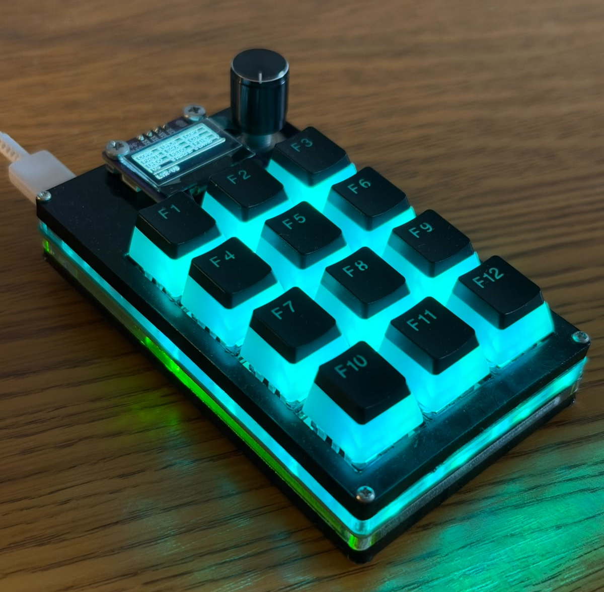
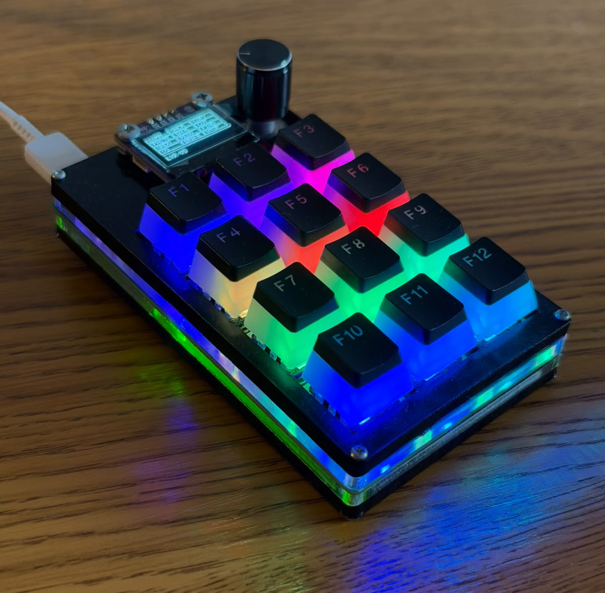
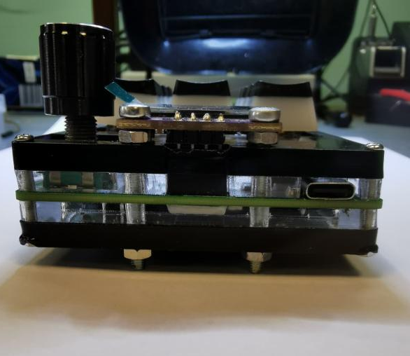
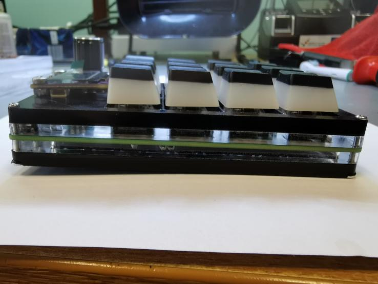

# MACRODECK

<!-- Add a photo of your finished Macropad here -->

This repository contains the hardware and software files for an open-source, programmable macropad keyboard based on the Arduino platform. Developed as a bachelor's thesis, this device allows users to store keyboard shortcuts directly on the hardware's memory, eliminating the need for complex PC software while improving daily workflow productivity.

## Features

- **Native USB HID Emulation:** Powered by an ATmega32U4 microcontroller with an integrated USB controller, meaning it works plug-and-play on any computer without extra drivers.
- **Mechanical Switch Matrix:** Features a 12-key grid with anti-ghosting diodes to prevent false key presses.
- **Hot-Swappable:** Utilizes hot-swap sockets for effortless mechanical switch replacement and testing.
- **Customizable RGB Lighting:** Addressable WS2812B NeoPixel LEDs provide per-key illumination with customizable static colors and dynamic effects.
- **On-Device Interface:** An integrated 0.96" I2C OLED display (SSD1306) and a rotary encoder allow users to navigate menus, select layers, and adjust PC volume directly from the device.
- **Persistent Memory:** Key bindings, macro steps, and layer names are permanently saved in the MCU's 1KB EEPROM.
- **Custom Real-Time Configuration Protocol:** Shortcuts can be reprogrammed in real-time via a serial UART interface using the Arduino IDE Serial Monitor or a Python script.
- **Custom Enclosure:** Designed with a 4-layer laser-cut acrylic (plexiglass) case.

---

## Hardware Bill of Materials (BOM)

The custom PCB was designed in KiCad. If you are assembling the board yourself, you will need the following components:

| Component                  | Description / Package                                            | Quantity |
| :------------------------- | :--------------------------------------------------------------- | :------- |
| **Microcontroller**        | ATmega32U4-AU (QFP-44 10x10)                                     | 1        |
| **USB Connector**          | USB 2.0 Type-C Receptacle 16-pin (SMD)                           | 1        |
| **Display**                | 0.96" OLED I2C SSD1306 (30x30)                                   | 1        |
| **Rotary Encoder**         | EC11 Rotary Switch (THT)                                         | 1        |
| **Mechanical Switches**    | Cherry MX Keyswitches (THT)                                      | 12       |
| **Hot-Swap Sockets**       | CPG151101S11-2 (SMD)                                             | 12       |
| **RGB Lighting LEDs**      | WS2812B NeoPixel LEDs                                            | 12       |
| **Anti-Ghosting Diodes**   | 1N4148W 75V 150mA (SOD-123)                                      | 12       |
| **Reset Switch**           | Tactile Switch 6.1x3.6mm (TS-1092S-B3D2-G)                       | 1        |
| **Crystal Oscillator**     | 16.000MHz SMD5032-2P (ABM3-16.000MHZ-D2Y-T)                      | 1        |
| **Protection**             | Schottky Diode 20V 500mA (MBR0520LT1G)                           | 1        |
| **Protection**             | Polymeric PTC Resettable Fuse 6V 500mA (SMD1206P050TF)           | 1        |
| **LED (Indication)**       | Blue 460nm LED (0603)                                            | 1        |
| **Resistors (0603)**       | 1kΩ (x1), 2.2kΩ (x2), 5.1kΩ (x2), 10kΩ (x2), 470Ω (x2), 22Ω (x2) | 11 Total |
| **Capacitors (0603/0805)** | 100nF (x6), 10uF (x1), 1uF (x1), 22pF (x2)                       | 10 Total |

---

## Building & Installation

1. **PCB & Enclosure:** The PCB manufacturing files are generated from KiCad. The enclosure is constructed from 4 layers of laser-cut black plexiglass.
2. **Bootloader:** A `USBasp` programmer is required to flash the initial bootloader to the ATmega32U4 chip using the ISP (In-System Programming) header.
3. **Firmware:** The firmware is written using the Arduino IDE. Once the bootloader is installed, you can flash updates directly via the USB-C port.

---

## Interface

The macropad operates on a Finite-State Machine with 8 distinct modes (states):

1. **NORMAL:** The primary working state. Scans for keypresses to execute macros and uses the rotary encoder to control PC volume.
2. **MAIN MENU:** Accessed by pressing the rotary encoder button. Allows navigation to other settings.
3. **LAYERS MENU:** Switch between different shortcut layers.
4. **LEDS MENU:** Access sub-menus for lighting.
5. **BRIGHTNESS MENU:** Adjust the intensity of the LED backlights.
6. **STATIC COLORS MENU:** Select a solid color for the keys.
7. **EFFECTS MENU:** Select dynamic RGB animations.
8. **PROG MODE (Programming):** Put the device into configuration mode to remap keys and rename layers via UART.

### Configuration Protocol (How to program macros?)

When the device is in `PROG MODE`, open the Arduino IDE Serial Monitor (or use a serial Python script) to send UART commands. Due to the 1KB EEPROM limit, each macro is restricted to a maximum of 10 sequential keystrokes.

- **To rename a layer**, send:
  `{{layer_id, layer_name}}`
- **To assign a shortcut to a key**, send:
  `<<layer_id, key_id, label, macro_steps>>`
- **To list all current shortcuts**, send:
  `?`

Whenever a programmed key is pressed in normal mode, a pop-up appears on the OLED display showing the executed shortcut (e.g., `CTRL+F`).
